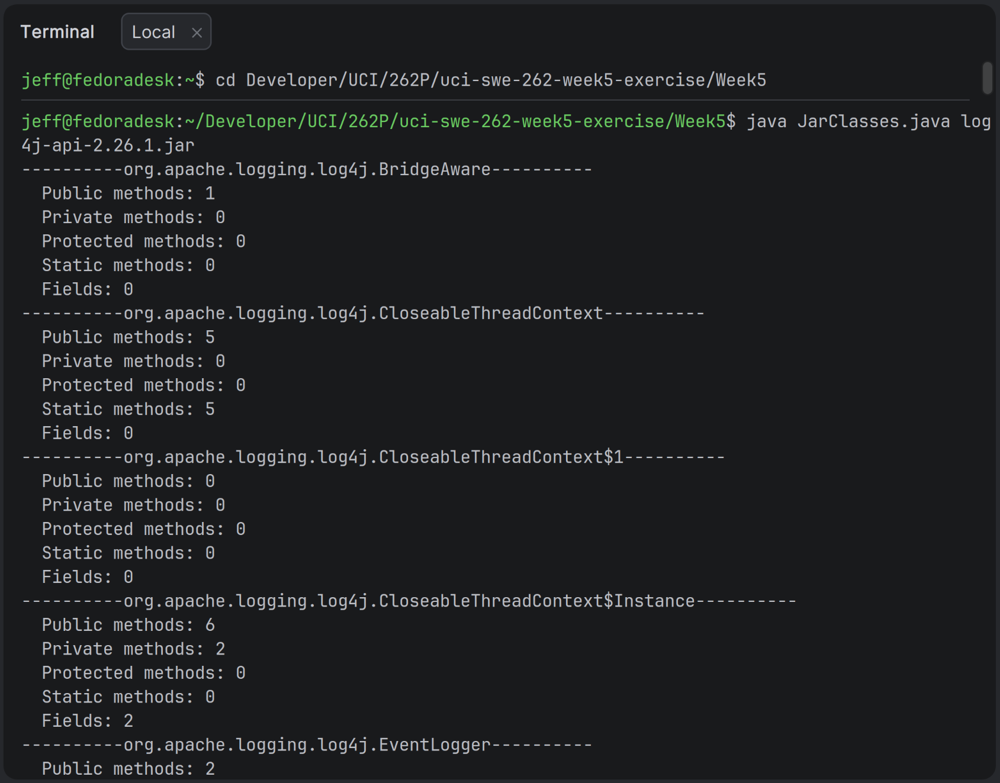

# Week 5 — JarClasses

## About

A Java program that inspects a `.jar` file using reflection and prints a
sorted, alphabetical listing of every class inside it, along with the number
of declared public, private, protected, and static methods, and the number of
declared fields.

## Development Setup

### Prerequisites

- [Install Java 25+.](https://www.oracle.com/java/technologies/downloads/)

### Run the Program

```bash
cd <<project-directory>>/Week5
java JarClasses.java <jar-file>
```

Example:

```bash
cd /home/usr/uci-swe-262-week5-exercise/Week5
java JarClasses.java log4j-api-2.26.1.jar
```

## Sample output

```text
----------org.apache.logging.log4j.BridgeAware----------
  Public methods: 1
  Private methods: 0
  Protected methods: 0
  Static methods: 0
  Fields: 0
----------org.apache.logging.log4j.CloseableThreadContext----------
  Public methods: 5
  Private methods: 0
  Protected methods: 0
  Static methods: 5
  Fields: 0
...
```

## How it works

- Reads each `.class` entry from the jar.
- Sorts the class names alphabetically.
- Loads each class with a `URLClassLoader`.
- Uses `java.lang.reflect` (`Method`, `Field`, `Modifier`) to count declared
  members.

## Evidence


